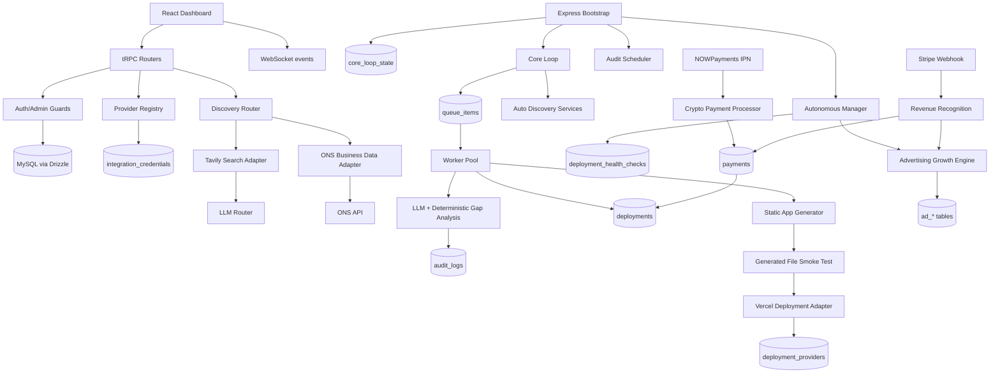
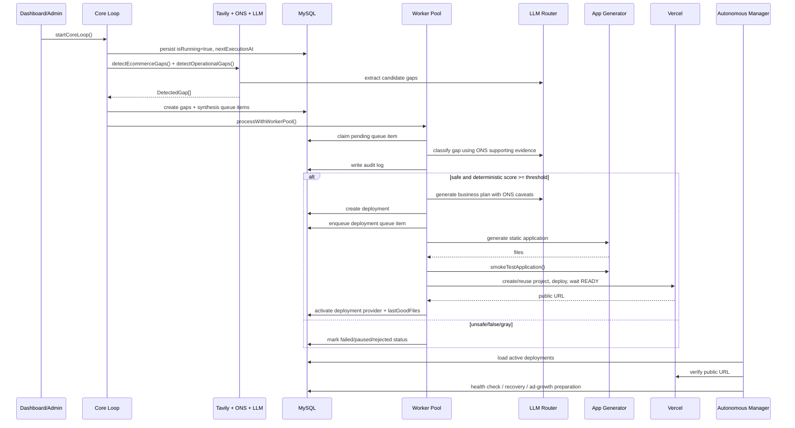

# SAO Full Lifecycle Logic Audit

Audit date: 2026-10-14  
Scope: existing SAO repository in this workspace.  
Mode: audit only. No application code, schema, migration, environment variable, deployment, payment, advertising, or production record was intentionally modified by this audit. This report file is the only audit artifact created.

## A. Executive Assessment

Overall readiness: **PARTIAL for internal orchestration; FAIL for a complete autonomous business lifecycle.**

SAO has a real backend, provider registry, persistent queue, core loop, ONS adapter, LLM routing, generated static application deployment path, payment ledger, ad-growth ledger, dashboard controls, audit logs, and several safety checks. The application can automatically discover candidate gaps when the core loop is running, classify them, create a business-plan record, enqueue deployment, generate a static app, smoke-test generated files, and deploy to Vercel if configured.

However, the implementation does not yet satisfy the full agreed autonomous business lifecycle. Major requirements are missing or only partially implemented: structured evidence persistence, rigorous market validation, master business specification authority, independent multi-agent separation, real sales/customer acquisition, live paid advertising, platform revenue-share settlement, lifecycle deadlines/extensions, and independent QC. Many "agents" are prompt roles or service functions rather than isolated permissioned actors. Several decisions are LLM-assisted with lightweight deterministic gates, not complete business-rule evaluation.

What is operational:

- Persistent core loop state, start/stop/resume after restart, interval updates, worker concurrency, retries and backoff: [server/orchestrator.ts:986](/home/ademoo/Downloads/0a7006299_SAO-NORTHFLANKtar_FILES/server/orchestrator.ts:986), [server/orchestrator.ts:1084](/home/ademoo/Downloads/0a7006299_SAO-NORTHFLANKtar_FILES/server/orchestrator.ts:1084), [server/db.ts:1374](/home/ademoo/Downloads/0a7006299_SAO-NORTHFLANKtar_FILES/server/db.ts:1374).
- Discovery via Tavily plus LLM extraction, with ONS used in `searchForGaps`, classification, and business-plan prompts: [server/services/search.ts:200](/home/ademoo/Downloads/0a7006299_SAO-NORTHFLANKtar_FILES/server/services/search.ts:200), [server/orchestrator.ts:641](/home/ademoo/Downloads/0a7006299_SAO-NORTHFLANKtar_FILES/server/orchestrator.ts:641), [server/orchestrator.ts:708](/home/ademoo/Downloads/0a7006299_SAO-NORTHFLANKtar_FILES/server/orchestrator.ts:708).
- ONS adapter with timeout, retry, cache, source attribution and caveats: [server/services/businessData.ts:86](/home/ademoo/Downloads/0a7006299_SAO-NORTHFLANKtar_FILES/server/services/businessData.ts:86), [server/services/businessData.ts:156](/home/ademoo/Downloads/0a7006299_SAO-NORTHFLANKtar_FILES/server/services/businessData.ts:156).
- Provider registry with `business_data` service type and ONS descriptor only: [server/services/providerRegistry.ts:16](/home/ademoo/Downloads/0a7006299_SAO-NORTHFLANKtar_FILES/server/services/providerRegistry.ts:16), [server/services/providerRegistry.ts:198](/home/ademoo/Downloads/0a7006299_SAO-NORTHFLANKtar_FILES/server/services/providerRegistry.ts:198).
- Verified payment recognition through Stripe webhook and NOWPayments IPN, with idempotent ledger update: [server/_core/index.ts:53](/home/ademoo/Downloads/0a7006299_SAO-NORTHFLANKtar_FILES/server/_core/index.ts:53), [server/services/crypto.ts:130](/home/ademoo/Downloads/0a7006299_SAO-NORTHFLANKtar_FILES/server/services/crypto.ts:130), [server/db.ts:1044](/home/ademoo/Downloads/0a7006299_SAO-NORTHFLANKtar_FILES/server/db.ts:1044).
- Paid advertising is explicitly blocked unless live mode, credentials, approval, and budget checks pass: [server/services/advertising/growthEngine.ts:191](/home/ademoo/Downloads/0a7006299_SAO-NORTHFLANKtar_FILES/server/services/advertising/growthEngine.ts:191), [server/services/advertising/channelAdapter.ts:149](/home/ademoo/Downloads/0a7006299_SAO-NORTHFLANKtar_FILES/server/services/advertising/channelAdapter.ts:149).

What is partial:

- Deployment is real only for generated static apps through Vercel. The generator forbids backend, secrets, server code, and authenticated APIs, so generated businesses are not full SaaS/product businesses: [server/services/applicationGenerator.ts:74](/home/ademoo/Downloads/0a7006299_SAO-NORTHFLANKtar_FILES/server/services/applicationGenerator.ts:74).
- QC exists as generator validation, smoke tests, Vercel readiness, audits, and health checks, but not as an independent QC agent with functional/integration/security authority separate from the developer path: [server/services/applicationGenerator.ts:268](/home/ademoo/Downloads/0a7006299_SAO-NORTHFLANKtar_FILES/server/services/applicationGenerator.ts:268), [server/orchestrator.ts:414](/home/ademoo/Downloads/0a7006299_SAO-NORTHFLANKtar_FILES/server/orchestrator.ts:414).
- Revenue is recorded, but platform/business 20% revenue-share settlement is not implemented. The observed 20% logic is advertising allocation, not platform settlement: [server/services/advertising/growthEngine.ts:104](/home/ademoo/Downloads/0a7006299_SAO-NORTHFLANKtar_FILES/server/services/advertising/growthEngine.ts:104), [server/services/advertising/growthEngine.ts:354](/home/ademoo/Downloads/0a7006299_SAO-NORTHFLANKtar_FILES/server/services/advertising/growthEngine.ts:354).

What is missing or simulated:

- Master Business Specification table/object and conflict/clarification workflow.
- Rich market scoring for willingness to pay, competition, feasibility, startup cost, operational complexity, profitability and regulatory risk.
- Independent multi-agent permission boundaries and backup-agent takeover.
- Real paid ad-network campaign creation; paid adapter returns `STUBBED`.
- Lead identification, authorized outreach, customer onboarding and retention workflows.
- Fixed business deadlines, extension offers, max extensions and deadline-driven shutdown.
- Northflank deployment execution; the live deployment path inspected is Vercel.

Verification performed during this audit:

- `npx tsc -p server/tsconfig.json --noEmit` passed.
- `npx tsc -p client/tsconfig.json --noEmit` passed.
- `npm test` passed all scripted unit/regression tests.
- `npm run build` passed.
- Live read-only ONS smoke test passed: `GET https://api.beta.ons.gov.uk/v1/datasets?limit=1` returned HTTP 200 with one item.
- Companies House/GOV.UK reference scan found no active matches for `Companies House`, `companies_house`, `COMPANIES_HOUSE_API_KEY`, `GOV.UK`, `govuk`, `GovUk`, `api.companieshouse`, or related removed integration strings.

## B. Actual Architecture

## C. Stage-by-Stage Logic

### 1. Startup and Scheduling

Trigger: Express bootstrap after environment loading and database readiness. The server initializes core loop state, resumes the loop if persisted `isRunning` is true, schedules audits, and schedules the autonomous manager: [server/_core/index.ts:217](/home/ademoo/Downloads/0a7006299_SAO-NORTHFLANKtar_FILES/server/_core/index.ts:217).

Input: environment variables, database connection, singleton `core_loop_state`.

Logic: `initCoreLoopState()` creates a singleton if absent with defaults; `startCoreLoop()` recovers stale processing items, persists running state, broadcasts status, and immediately launches a guarded tick: [server/db.ts:1389](/home/ademoo/Downloads/0a7006299_SAO-NORTHFLANKtar_FILES/server/db.ts:1389), [server/orchestrator.ts:1084](/home/ademoo/Downloads/0a7006299_SAO-NORTHFLANKtar_FILES/server/orchestrator.ts:1084).

Failure: database readiness failures stop bootstrap after bounded retries; core-loop tick crashes are caught and rescheduled when persisted state still says running: [server/orchestrator.ts:1066](/home/ademoo/Downloads/0a7006299_SAO-NORTHFLANKtar_FILES/server/orchestrator.ts:1066).

Assessment: **PARTIAL PASS.** Startup/resume behavior exists. It depends on a live DB and does not prove downstream provider availability.

### 2. Discovery

Trigger: core-loop tick or admin discovery router calls. Core loop calls `detectEcommerceGaps()` and `detectOperationalGaps()` every configured tick: [server/orchestrator.ts:1001](/home/ademoo/Downloads/0a7006299_SAO-NORTHFLANKtar_FILES/server/orchestrator.ts:1001).

Sources: Tavily search for fixed e-commerce and operational queries; ONS supporting evidence in `searchForGaps()`; LLM extraction from snippets: [server/services/search.ts:346](/home/ademoo/Downloads/0a7006299_SAO-NORTHFLANKtar_FILES/server/services/search.ts:346), [server/services/search.ts:403](/home/ademoo/Downloads/0a7006299_SAO-NORTHFLANKtar_FILES/server/services/search.ts:403), [server/services/search.ts:200](/home/ademoo/Downloads/0a7006299_SAO-NORTHFLANKtar_FILES/server/services/search.ts:200).

Provider usage: Tavily credential resolution uses provider registry then env fallback: [server/services/search.ts:125](/home/ademoo/Downloads/0a7006299_SAO-NORTHFLANKtar_FILES/server/services/search.ts:125). ONS does not require credentials and was live-smoke verified during audit. Companies House and GOV.UK active references were not found.

Deduplication: auto-discovery normalizes/lowercases fields and hashes `knows|needs|controlsAccess|underestimatesValue|source` before insert: [server/orchestrator.ts:934](/home/ademoo/Downloads/0a7006299_SAO-NORTHFLANKtar_FILES/server/orchestrator.ts:934). Manual discovery router paths use an unnormalized concatenation: [server/routers.ts:944](/home/ademoo/Downloads/0a7006299_SAO-NORTHFLANKtar_FILES/server/routers.ts:944).

Persistence: `gaps` store only the four SAO fields, a source string, status, priority and dedup hash. There is no structured evidence table for retrieval date, period, geography, contradiction handling or confidence: [drizzle/schema.ts:15](/home/ademoo/Downloads/0a7006299_SAO-NORTHFLANKtar_FILES/drizzle/schema.ts:15).

Failure: Tavily not configured returns empty results and updates in-memory discovery status; LLM extraction metrics track error categories; ONS failures are converted into unavailable-provider notes but not persisted with gap records: [server/services/search.ts:131](/home/ademoo/Downloads/0a7006299_SAO-NORTHFLANKtar_FILES/server/services/search.ts:131), [server/services/search.ts:80](/home/ademoo/Downloads/0a7006299_SAO-NORTHFLANKtar_FILES/server/services/search.ts:80), [server/services/businessData.ts:260](/home/ademoo/Downloads/0a7006299_SAO-NORTHFLANKtar_FILES/server/services/businessData.ts:260).

Assessment: **PARTIAL.** Discovery executes, but genuine opportunity detection relies on fixed queries plus LLM extraction and does not persist structured evidence/confidence.

### 3. Gap Analysis and Qualification

Trigger: worker claims a synthesis queue item and calls `classifyGap()`: [server/orchestrator.ts:225](/home/ademoo/Downloads/0a7006299_SAO-NORTHFLANKtar_FILES/server/orchestrator.ts:225).

Inputs: gap fields, ONS evidence formatted for prompt, LLM classification, deterministic score.

Formula: `scoreGap()` gives up to 48 points for field specificity, +18 economic urgency keywords, +14 evidence keywords, +12 access-control keywords, +10 value-mismatch keywords, -25 weak-evidence keywords, -15 contradictory-evidence keywords; threshold is 60. A safe LLM result below 60 is downgraded to gray: [server/services/gapAnalysis.ts:27](/home/ademoo/Downloads/0a7006299_SAO-NORTHFLANKtar_FILES/server/services/gapAnalysis.ts:27), [server/services/gapAnalysis.ts:43](/home/ademoo/Downloads/0a7006299_SAO-NORTHFLANKtar_FILES/server/services/gapAnalysis.ts:43), [server/services/gapAnalysis.ts:90](/home/ademoo/Downloads/0a7006299_SAO-NORTHFLANKtar_FILES/server/services/gapAnalysis.ts:90).

Coverage gaps: no implemented formulas for market size, competitor intensity, willingness to pay, startup cost, time to launch, operational complexity, revenue potential, profitability, regulatory risk, or technical feasibility. Those may appear in LLM text but are not enforced as deterministic qualification gates.

Failure: unsafe/false become failed; gray becomes paused/manual review; safe continues: [server/orchestrator.ts:311](/home/ademoo/Downloads/0a7006299_SAO-NORTHFLANKtar_FILES/server/orchestrator.ts:311).

Assessment: **PARTIAL.** There is a deterministic gate, but it is too shallow to satisfy the agreed qualification model. Weak evidence can be downgraded by keywords, but absence of structured evidence is not a hard block.

### 4. Queue, Scheduling and Worker Allocation

Trigger: core loop calls `processWithWorkerPool()`; manual `runOnce` calls `processOneGap()`: [server/orchestrator.ts:1022](/home/ademoo/Downloads/0a7006299_SAO-NORTHFLANKtar_FILES/server/orchestrator.ts:1022), [server/routers.ts:747](/home/ademoo/Downloads/0a7006299_SAO-NORTHFLANKtar_FILES/server/routers.ts:747).

Queue model: persistent `queue_items` support status, queue type, worker, attempts, retry time, priority and sort order: [drizzle/schema.ts:29](/home/ademoo/Downloads/0a7006299_SAO-NORTHFLANKtar_FILES/drizzle/schema.ts:29).

Concurrency: dashboard setting persists to `core_loop_state`; worker pool reads it and clamps 1-10: [server/orchestrator.ts:1201](/home/ademoo/Downloads/0a7006299_SAO-NORTHFLANKtar_FILES/server/orchestrator.ts:1201), [server/routers.ts:1357](/home/ademoo/Downloads/0a7006299_SAO-NORTHFLANKtar_FILES/server/routers.ts:1357).

Retry/backoff: processing failures requeue with `baseDelayMs * backoffMultiplier^(attempts-1)` until max attempts, then mark failed: [server/orchestrator.ts:878](/home/ademoo/Downloads/0a7006299_SAO-NORTHFLANKtar_FILES/server/orchestrator.ts:878).

Race prevention: `claimNextPendingQueueItem()` selects the next item then updates it with `WHERE id AND status='pending'`, checking affected rows: [server/db.ts:500](/home/ademoo/Downloads/0a7006299_SAO-NORTHFLANKtar_FILES/server/db.ts:500). This is useful optimistic locking but not a full transactional dequeue.

Capacity: queue max size is persisted and alert-checked, but not enforced in `createQueueItem()`: [server/db.ts:416](/home/ademoo/Downloads/0a7006299_SAO-NORTHFLANKtar_FILES/server/db.ts:416), [server/routers.ts:1334](/home/ademoo/Downloads/0a7006299_SAO-NORTHFLANKtar_FILES/server/routers.ts:1334).

Assessment: **PARTIAL PASS.** Core mechanics exist; capacity, dedup and transaction guarantees are incomplete.

### 5. Business Selection and Strategy

Trigger: safe classified gap.

Logic: `generateBusinessPlan()` asks the LLM for a micro-startup execution plan with ONS caveats and stores it as `deployments.businessPlan`: [server/orchestrator.ts:708](/home/ademoo/Downloads/0a7006299_SAO-NORTHFLANKtar_FILES/server/orchestrator.ts:708), [server/db.ts:622](/home/ademoo/Downloads/0a7006299_SAO-NORTHFLANKtar_FILES/server/db.ts:622).

Master Business Specification: not found. The schema has `businessPlan` text only; no authoritative structured spec, decision log, conflict-resolution record, or clarification object: [drizzle/schema.ts:46](/home/ademoo/Downloads/0a7006299_SAO-NORTHFLANKtar_FILES/drizzle/schema.ts:46).

Clarification rules: no implementation found for "three questions per issue" or required user selections before build.

Assessment: **FAIL against agreed requirement.** SAO creates a textual plan, not a governed master spec.

### 6. Multi-Agent Orchestration

Observed implementation: central orchestrator, LLM facade/router, application generator, advertising growth functions, audit scheduler, autonomous manager, provider adapters and dashboard routers. The repo does not implement separate persistent agent identities for CEO, Strategy, Market Research, CTO, Developer, Designer, Marketing, Sales, Finance, Customer Support, Analytics, Operations, independent QC, or backup agents with permission boundaries.

Supervisor boundary: admin/protected tRPC guards exist: [server/_core/trpc.ts:18](/home/ademoo/Downloads/0a7006299_SAO-NORTHFLANKtar_FILES/server/_core/trpc.ts:18). High-risk external paths are gated by configuration or admin operations, but "agents cannot bypass supervisor" is not modeled as an agent permission system.

Assessment: **FAIL for full multi-agent specification; PARTIAL for centralized orchestration.**

### 7. Business Generation

Trigger: deployment queue item.

Path: deployment queue loads the deployment, generates static app files, smoke-tests them, creates/reuses Vercel project, deploys, waits READY, resolves public URL, stores active provider and last-good files: [server/orchestrator.ts:349](/home/ademoo/Downloads/0a7006299_SAO-NORTHFLANKtar_FILES/server/orchestrator.ts:349).

Generator limits: system prompt requires static HTML/CSS/JS only; no backend, no server, no secrets, no authenticated APIs: [server/services/applicationGenerator.ts:74](/home/ademoo/Downloads/0a7006299_SAO-NORTHFLANKtar_FILES/server/services/applicationGenerator.ts:74).

Validation: generated file structure, file count/size, forbidden patterns, entry point and references are checked: [server/services/applicationGenerator.ts:126](/home/ademoo/Downloads/0a7006299_SAO-NORTHFLANKtar_FILES/server/services/applicationGenerator.ts:126), [server/services/applicationGenerator.ts:268](/home/ademoo/Downloads/0a7006299_SAO-NORTHFLANKtar_FILES/server/services/applicationGenerator.ts:268).

Assessment: **PARTIAL.** It can generate and deploy a static app, not a complete operating business with backend, database, payments, support and operational integrations.

### 8. Independent Quality Control

Implemented checks: generated-app validation/smoke test before deployment, Vercel readiness wait, public URL resolution, audit scheduler, autonomous manager health checks: [server/orchestrator.ts:414](/home/ademoo/Downloads/0a7006299_SAO-NORTHFLANKtar_FILES/server/orchestrator.ts:414), [server/auditScheduler.ts:134](/home/ademoo/Downloads/0a7006299_SAO-NORTHFLANKtar_FILES/server/auditScheduler.ts:134), [server/autonomousManager.ts:197](/home/ademoo/Downloads/0a7006299_SAO-NORTHFLANKtar_FILES/server/autonomousManager.ts:197).

Missing: independent QC agent, functional browser tests for generated apps, security/authorization testing of generated businesses, repair-task loop with independent re-approval, backup agent takeover.

Assessment: **FAIL for independent QC requirement; PARTIAL for automated smoke/health checks.**

### 9. Deployment and Production Operation

Provider path: Vercel only in actual deployment code inspected. Northflank live deployment was not found in the runtime deployment path. Vercel credential is registry/env resolved in the deployment service, and the orchestrator does not mark a new provider active until after readiness and URL verification: [server/orchestrator.ts:428](/home/ademoo/Downloads/0a7006299_SAO-NORTHFLANKtar_FILES/server/orchestrator.ts:428), [server/orchestrator.ts:457](/home/ademoo/Downloads/0a7006299_SAO-NORTHFLANKtar_FILES/server/orchestrator.ts:457).

Rollback/recovery: autonomous manager can redeploy and rollback to `lastGoodFiles` after health failures: [server/autonomousManager.ts:283](/home/ademoo/Downloads/0a7006299_SAO-NORTHFLANKtar_FILES/server/autonomousManager.ts:283), [server/autonomousManager.ts:329](/home/ademoo/Downloads/0a7006299_SAO-NORTHFLANKtar_FILES/server/autonomousManager.ts:329).

Approval: deployment queue can run automatically after safe classification; no explicit user approval gate was found for normal Vercel deployment.

Assessment: **PARTIAL.** Real Vercel path with verification exists, but full production operations, Northflank assumptions, migrations and approval gates are incomplete.

### 10. Payments, Revenue and Finance

Stripe: verified webhook signature required; session revenue recognized into canonical ledger: [server/_core/index.ts:53](/home/ademoo/Downloads/0a7006299_SAO-NORTHFLANKtar_FILES/server/_core/index.ts:53).

NOWPayments: server-controlled fixed price defaults to USD 10.00; IPN signature is verified; paid status records revenue and enqueues deployment once: [server/services/crypto.ts:56](/home/ademoo/Downloads/0a7006299_SAO-NORTHFLANKtar_FILES/server/services/crypto.ts:56), [server/services/crypto.ts:130](/home/ademoo/Downloads/0a7006299_SAO-NORTHFLANKtar_FILES/server/services/crypto.ts:130).

Idempotency: `recordPaymentPaid()` uses a DB transaction and row locks to prevent duplicate revenue recognition: [server/db.ts:1044](/home/ademoo/Downloads/0a7006299_SAO-NORTHFLANKtar_FILES/server/db.ts:1044).

20% model discrepancy: code implements a default 20% advertising allocation from realized payments, not a platform revenue share/settlement ledger. No platform-vs-business split table or settlement workflow was found: [server/services/advertising/growthEngine.ts:104](/home/ademoo/Downloads/0a7006299_SAO-NORTHFLANKtar_FILES/server/services/advertising/growthEngine.ts:104), [server/services/advertising/growthEngine.ts:354](/home/ademoo/Downloads/0a7006299_SAO-NORTHFLANKtar_FILES/server/services/advertising/growthEngine.ts:354).

Assessment: **PARTIAL for payment recording; FAIL for agreed free-to-use 20% platform revenue-share settlement.**

### 11. Advertising and Growth

Budget: advertising allocation uses revenue percentage, defaulting to 20% in growth engine and configurable by env: [server/services/advertising/growthEngine.ts:104](/home/ademoo/Downloads/0a7006299_SAO-NORTHFLANKtar_FILES/server/services/advertising/growthEngine.ts:104).

Approvals: paid spend checks require live mode, paid campaign status, approval, configured channel, available funds, campaign limits, daily limits and emergency stop not active: [server/services/advertising/growthEngine.ts:191](/home/ademoo/Downloads/0a7006299_SAO-NORTHFLANKtar_FILES/server/services/advertising/growthEngine.ts:191), [server/services/advertising/growthEngine.ts:421](/home/ademoo/Downloads/0a7006299_SAO-NORTHFLANKtar_FILES/server/services/advertising/growthEngine.ts:421).

Publishing: organic campaigns are generated/marked internal; paid channels with credentials still return an explicit `STUBBED / NOT_ACTIVE` error. No real ad-network purchase occurs: [server/services/advertising/channelAdapter.ts:137](/home/ademoo/Downloads/0a7006299_SAO-NORTHFLANKtar_FILES/server/services/advertising/channelAdapter.ts:137), [server/services/advertising/channelAdapter.ts:149](/home/ademoo/Downloads/0a7006299_SAO-NORTHFLANKtar_FILES/server/services/advertising/channelAdapter.ts:149).

Optimization: campaign events, metrics, A/B experiments and optimization decisions exist, but results depend on internal/provider events being recorded: [server/services/advertising/growthEngine.ts:595](/home/ademoo/Downloads/0a7006299_SAO-NORTHFLANKtar_FILES/server/services/advertising/growthEngine.ts:595), [server/services/advertising/growthEngine.ts:696](/home/ademoo/Downloads/0a7006299_SAO-NORTHFLANKtar_FILES/server/services/advertising/growthEngine.ts:696).

Assessment: **PARTIAL.** Safe planning and accounting are present; real paid acquisition is not implemented.

### 12. Sales and Customer Acquisition

Observed code supports advertising planning, organic campaign preparation, payment links and static generated apps. No implementation was found for lead identification, customer qualification, outbound authorization, sales workflows, onboarding, retention or conversion handling beyond campaign events and payment ledger.

Assessment: **FAIL.**

### 13. Continuous Business Operation

Autonomous manager: monitors active Vercel deployments, verifies URL, records failures, redeploys/rolls back, prepares organic ad campaigns and optimizes active campaigns: [server/autonomousManager.ts:87](/home/ademoo/Downloads/0a7006299_SAO-NORTHFLANKtar_FILES/server/autonomousManager.ts:87), [server/autonomousManager.ts:197](/home/ademoo/Downloads/0a7006299_SAO-NORTHFLANKtar_FILES/server/autonomousManager.ts:197), [server/services/advertising/growthEngine.ts:891](/home/ademoo/Downloads/0a7006299_SAO-NORTHFLANKtar_FILES/server/services/advertising/growthEngine.ts:891).

Limit: improvements can be LLM-generated plan changes from health status, but there is no robust feedback, support, customer, expense, market-change or competitor-change measurement loop.

Assessment: **PARTIAL.**

### 14. Deadlines, Extensions and Shutdown

Implemented shutdown: autonomous manager stops deployments after repeated health failures, not after fixed platform business deadlines: [server/autonomousManager.ts:418](/home/ademoo/Downloads/0a7006299_SAO-NORTHFLANKtar_FILES/server/autonomousManager.ts:418).

Missing: fixed platform-controlled deadline, user inability to change it, deadline warnings, extension pricing, max extensions, final reports, deadline-based termination.

Assessment: **FAIL.**

### 15. Risk Management and Approvals

Implemented: admin/protected routes, provider secret redaction, encrypted credential storage, generated-app forbidden patterns, high-ban-risk auto-pause, advertising emergency stop and paid-spend authorization: [server/_core/trpc.ts:33](/home/ademoo/Downloads/0a7006299_SAO-NORTHFLANKtar_FILES/server/_core/trpc.ts:33), [server/services/providerRegistry.ts:263](/home/ademoo/Downloads/0a7006299_SAO-NORTHFLANKtar_FILES/server/services/providerRegistry.ts:263), [server/services/applicationGenerator.ts:57](/home/ademoo/Downloads/0a7006299_SAO-NORTHFLANKtar_FILES/server/services/applicationGenerator.ts:57), [server/autonomousManager.ts:163](/home/ademoo/Downloads/0a7006299_SAO-NORTHFLANKtar_FILES/server/autonomousManager.ts:163).

Missing/weak: mandatory safety rules are not modeled as immutable policies; user/admin can set concurrency to 10 despite UI warning about one-gap-at-a-time policy; deployment approval gates are not universal; reset operational data is available to admins and destructive: [client/src/pages/dashboard/Settings.tsx:449](/home/ademoo/Downloads/0a7006299_SAO-NORTHFLANKtar_FILES/client/src/pages/dashboard/Settings.tsx:449), [server/routers.ts:723](/home/ademoo/Downloads/0a7006299_SAO-NORTHFLANKtar_FILES/server/routers.ts:723).

Assessment: **PARTIAL.**

### 16. Dashboard-to-Backend Correctness

Confirmed wired controls:

- Overview start/stop/run once/audit call core-loop routers: [client/src/pages/dashboard/Overview.tsx:30](/home/ademoo/Downloads/0a7006299_SAO-NORTHFLANKtar_FILES/client/src/pages/dashboard/Overview.tsx:30), [server/routers.ts:735](/home/ademoo/Downloads/0a7006299_SAO-NORTHFLANKtar_FILES/server/routers.ts:735).
- Settings save interval, cost, deployment limit, risk pause and notifications; interval reschedules the running loop: [client/src/pages/dashboard/Settings.tsx:155](/home/ademoo/Downloads/0a7006299_SAO-NORTHFLANKtar_FILES/client/src/pages/dashboard/Settings.tsx:155), [server/routers.ts:1232](/home/ademoo/Downloads/0a7006299_SAO-NORTHFLANKtar_FILES/server/routers.ts:1232).
- Retry, queue limits and concurrency have backend mutations: [client/src/pages/dashboard/Settings.tsx:330](/home/ademoo/Downloads/0a7006299_SAO-NORTHFLANKtar_FILES/client/src/pages/dashboard/Settings.tsx:330), [server/routers.ts:1308](/home/ademoo/Downloads/0a7006299_SAO-NORTHFLANKtar_FILES/server/routers.ts:1308).
- Providers dashboard lists known providers, saves/tests credentials and toggles enabled status; ONS appears as credential-free business-data provider: [client/src/pages/dashboard/Providers.tsx:5](/home/ademoo/Downloads/0a7006299_SAO-NORTHFLANKtar_FILES/client/src/pages/dashboard/Providers.tsx:5), [server/services/providerRegistry.ts:198](/home/ademoo/Downloads/0a7006299_SAO-NORTHFLANKtar_FILES/server/services/providerRegistry.ts:198).

Controls with caveats:

- Queue max size is saved but not enforced on queue insert.
- `settings.setInterval` allows 5 seconds while `coreLoop.updateInterval` requires 60 seconds, creating inconsistent route semantics: [server/routers.ts:759](/home/ademoo/Downloads/0a7006299_SAO-NORTHFLANKtar_FILES/server/routers.ts:759), [server/routers.ts:1403](/home/ademoo/Downloads/0a7006299_SAO-NORTHFLANKtar_FILES/server/routers.ts:1403).
- Dashboard control inventory tests verify presence and backend markers, not full behavioral end-to-end correctness.

Assessment: **PARTIAL.**

## D. Evidence Summary

Confirmed code behavior:

- ONS-only business-data adapter exists; Companies House/GOV.UK active integration references absent.
- Core loop auto-discovers and processes queue while running.
- Queue/retry/concurrency are persisted and consumed at runtime.
- Generated apps are static-only and smoke-tested before Vercel deployment.
- Revenue recognition is idempotent.
- Paid advertising cannot start under current adapter implementation because live paid publish is stubbed.

Passing tests:

- Server TypeScript: passed.
- Client TypeScript: passed.
- `npm test`: passed.
- Production build: passed.
- ONS live smoke: passed.

Mocked behavior:

- `tests/business-data.test.ts` mocked ONS adapter behavior.
- Payment, advertising, provider registry and dashboard tests are mostly deterministic unit/regression tests.

Live verification:

- ONS public API read-only smoke returned HTTP 200 with one dataset item.

Assumptions:

- I did not perform live Vercel deployment, live Stripe/NOWPayments payment, paid ad publishing, destructive migration, or production data reset.
- I treated the current dirty worktree as pre-existing project state and did not revert it.

## E. Gap Register

| ID | Severity | Expected | Actual | Root cause | Affected modules | Impact | Recommended correction | Test needed |
|---|---|---|---|---|---|---|---|---|
| SAO-AUD-001 | Critical | Full lifecycle can create a valid business end-to-end | Static app pipeline only; sales/support/backend/customer operation missing | Generator constrained to static files; no full business spec/runtime | `applicationGenerator`, `orchestrator`, schema | Cannot create a complete operating business | Add structured business build system with backend/payment/support modules | Deterministic e2e mock from approved spec to functioning app with backend |
| SAO-AUD-002 | Critical | Master Business Specification is authoritative | Only `businessPlan` text exists | Missing schema/domain model | `deployments`, `orchestrator` | Conflicting decisions can be overwritten or lost | Add spec table/versioning/conflict log | Spec conflict and clarification tests |
| SAO-AUD-003 | High | Evidence records persist source, URL, retrieval date, period, geography, caveats | ONS evidence is prompt-only; gap table stores source string | Missing evidence persistence layer | `businessData`, `search`, schema | Cannot audit evidence after decisions | Add `evidence_records` linked to gap/decision | Evidence persistence and stale-evidence tests |
| SAO-AUD-004 | High | Qualification covers market demand, competition, WTP, cost, profitability and risk | Scoring is keyword/length plus LLM classification | Shallow deterministic model | `gapAnalysis` | Weak opportunities may pass or be paused for wrong reasons | Implement explicit score model and thresholds | Table-driven qualification tests |
| SAO-AUD-005 | High | Independent QC blocks deployment on critical failures | Same pipeline smoke-tests generated files; no independent QC agent | No agent separation/QC workflow | `orchestrator`, `applicationGenerator` | Developer path can approve its own output | Add QC queue/agent and independent test evidence | Failed functional test generates repair task and re-QC |
| SAO-AUD-006 | High | Paid ads publish only after approval and live integration | Safety gate exists; paid publish is not implemented | Adapter stub | `advertising/channelAdapter` | Cannot acquire real paid traffic | Implement provider APIs behind explicit live approvals | Paid campaign dry-run and sandbox provider tests |
| SAO-AUD-007 | High | Platform 20% revenue share is enforced | 20% applies to ad allocation, not platform settlement | Missing settlement ledger | `payments`, `revenue`, `advertising/growthEngine` | Business model mismatch | Add platform/business split ledger and reports | Payment splits 20/80 idempotently |
| SAO-AUD-008 | High | Deadlines/extensions/shutdown policy enforced | Only health-failure auto-stop exists | No deadline model | schema, `autonomousManager`, dashboard | Lifecycle policy unenforced | Add deadline/extension schema and scheduler | Deadline warning/extension/shutdown tests |
| SAO-AUD-009 | Medium | Queue max size prevents over-admission | Setting saved but not enforced | `createQueueItem` ignores `queueMaxSize` | `db`, `orchestrator`, settings | Queue can grow beyond configured limit | Enforce or backpressure inserts | Queue-capacity test |
| SAO-AUD-010 | Medium | Discovery dedup is consistent | Auto path normalizes; router path does not | Duplicate hashing duplicated in callers | `orchestrator`, `routers` | Duplicate gaps possible | Centralize dedup hash function | Same gap via API and loop dedups |
| SAO-AUD-011 | Medium | Agents have identities, permissions and backup takeover | Services/functions only | Missing agent runtime model | all agent-named workflows | Unauthorized-action model unverified | Implement agent registry, scopes, supervisor approvals | Agent permission and takeover tests |
| SAO-AUD-012 | Medium | Dashboard settings map cleanly to runtime | Some controls persist only or conflict semantically | Mixed router contracts | `routers`, `Settings.tsx` | Admin believes controls enforce more than they do | Align UI labels and backend enforcement | Dashboard-to-runtime integration tests |
| SAO-AUD-013 | Medium | Customer acquisition includes sales/outreach/onboarding | Not found beyond ads/payment | Missing sales domain | advertising, payments | No proof of real customer conversion | Add sales/CRM workflow with authorization | Mock lead-to-customer lifecycle test |
| SAO-AUD-014 | Low | Deployment provider assumptions include Northflank where applicable | Runtime path is Vercel | No Northflank adapter in deployment path inspected | `orchestrator`, deployment services | Provider expectation mismatch | Document or implement Northflank path | Provider selection tests |
| SAO-AUD-015 | Low | Core loop interval validation is consistent | One route min 60s, another min 5s | Duplicated route validation | `routers` | Confusing runtime controls | Use one interval mutation/schema | Boundary validation tests |

## F. End-to-End Assessment

Discovery -> Evidence: **PARTIAL.** Tavily/LLM and ONS can retrieve inputs, but structured evidence is not persisted.

Evidence -> Deduplication: **PARTIAL.** Hashing exists, but inconsistent between auto and router paths.

Deduplication -> Gap Scoring: **PARTIAL.** Queue creation is real; scoring is shallow and only sees gap text/source.

Gap Scoring -> Qualification: **PARTIAL.** Deterministic threshold blocks weak safe classifications, but important criteria are absent.

Qualification -> Business Specification: **FAIL.** Text plan is generated; no master spec.

Specification -> Agent Assignment: **FAIL.** No independent agent assignment/runtime boundary.

Agent Assignment -> Development: **PARTIAL.** Static app generation occurs; not a full business build.

Development -> QC: **PARTIAL/FAIL.** Smoke tests exist; independent QC missing.

QC -> Deployment: **PARTIAL.** Vercel deployment is gated by smoke test/readiness; no broad approval workflow.

Deployment -> Production Health: **PARTIAL.** Autonomous manager checks URLs and recovers/rolls back.

Production Health -> Customer Acquisition: **PARTIAL/FAIL.** Organic campaign plans are prepared; paid channels are stubbed.

Customer Acquisition -> Revenue: **PARTIAL.** Payments can be recorded if external checkout/webhook occurs; no customer acquisition proof.

Revenue -> Advertising/Reinvestment: **PARTIAL.** Advertising allocation exists; not platform revenue share.

Monitoring -> Optimization: **PARTIAL.** Campaign optimization works from recorded events; broader business health optimization is thin.

Optimization -> Deadline/Extension/Shutdown: **FAIL.** No deadline/extension lifecycle.

Failure Recovery -> Resume: **PARTIAL.** Queue stale recovery, tick reschedule and deployment rollback exist, but not full lifecycle recovery.

## G. Final Verdict

| Question | Verdict | Evidence |
|---|---|---|
| Can SAO autonomously discover a valid business opportunity? | PARTIAL | It can discover candidate gaps via Tavily/LLM and ONS support, but validation evidence and scoring are incomplete. |
| Can it build a functioning business? | PARTIAL/FAIL | It can build a static app, not a complete operating business. |
| Can it independently verify quality? | FAIL | Smoke tests exist, but no independent QC agent/workflow. |
| Can it deploy safely? | PARTIAL | Vercel path verifies readiness and URL, but approvals and full production checks are incomplete. |
| Can it acquire real customers? | NOT VERIFIED/FAIL | No sales workflow; paid advertising is stubbed; organic campaigns are internal plans. |
| Can it collect and attribute actual revenue? | PARTIAL | Payment ledger/webhooks are real and idempotent; attribution/customer linkage and platform split are incomplete. |
| Can it operate and improve continuously? | PARTIAL | Health monitoring, recovery and ad optimization exist; customer/support/market loops are missing. |
| Can it enforce deadlines and shutdown rules? | FAIL | Health-failure shutdown exists; deadline/extension policy absent. |
| Can it recover from failures and resume correctly? | PARTIAL | Stale queue recovery, tick reschedule, redeploy and rollback exist; full lifecycle recovery is not complete. |

## H. Removed Provider Audit

The business-data provider registry currently contains `ons` as the only `business_data` provider. The active code search found no remaining active references to Companies House, `companies_house`, `COMPANIES_HOUSE_API_KEY`, GOV.UK, `govuk`, `GovUk`, `api.companieshouse`, or GOV.UK content API integration strings. ONS remains operational and live-smoke verified.

Relevant files:

- ONS adapter and evidence formatting: [server/services/businessData.ts](/home/ademoo/Downloads/0a7006299_SAO-NORTHFLANKtar_FILES/server/services/businessData.ts)
- Registry descriptor: [server/services/providerRegistry.ts:198](/home/ademoo/Downloads/0a7006299_SAO-NORTHFLANKtar_FILES/server/services/providerRegistry.ts:198)
- Discovery use: [server/services/search.ts:200](/home/ademoo/Downloads/0a7006299_SAO-NORTHFLANKtar_FILES/server/services/search.ts:200)
- Classification and business-plan use: [server/orchestrator.ts:641](/home/ademoo/Downloads/0a7006299_SAO-NORTHFLANKtar_FILES/server/orchestrator.ts:641), [server/orchestrator.ts:708](/home/ademoo/Downloads/0a7006299_SAO-NORTHFLANKtar_FILES/server/orchestrator.ts:708)
- Audit use: [server/auditScheduler.ts:76](/home/ademoo/Downloads/0a7006299_SAO-NORTHFLANKtar_FILES/server/auditScheduler.ts:76)

## I. Worktree Note

At audit time, the repository already contained modified/untracked files from the recent business-data integration/removal work: `.env.example`, `client/src/pages/dashboard/Providers.tsx`, `package.json`, `server/auditScheduler.ts`, `server/orchestrator.ts`, `server/routers.ts`, `server/services/providerRegistry.ts`, `server/services/search.ts`, `tests/provider-registry-unit.test.ts`, plus untracked `server/services/businessData.ts` and `tests/business-data.test.ts`. This audit did not revert or alter those files.

